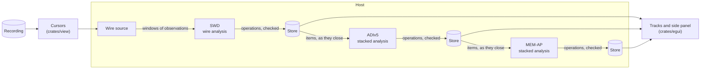
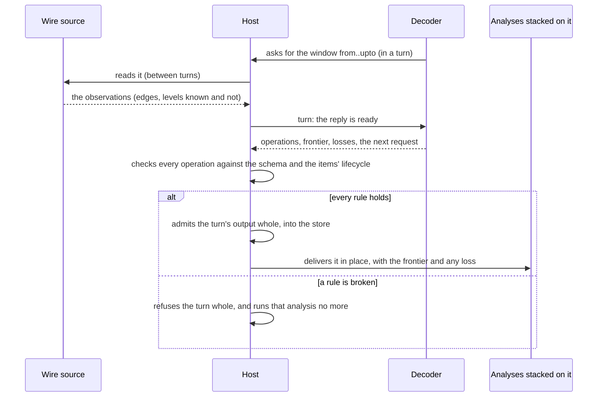
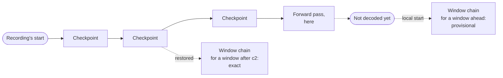

# Protocol decoding

tickwave decodes the protocols in a recording, such as SWD, JTAG and cJTAG, and draws what they
carried under the graph. This document describes how that works: the parts, how data moves between
them, and the rules a decoder keeps. It is for someone writing a decoder, or a program that runs
them. The API itself is documented in the crates: `crates/decode` holds the contract and the host,
and `crates/decoders` the reference decoders.

## The parts

A decoder turns input into items: a transfer, a scan, a register access. Each item has a start and
an end in time, fields with values, and links to other items. A decoder declares what it emits up
front, in its definition: its name and version, its inputs, its settings, and the schema of its
items.

An analysis is a decoder bound to its input with its settings, in a host. The host runs every
analysis, checks everything each one emits, and keeps what the views ask for. An analysis reads one
of two kinds of input:

- A wire analysis reads channels of a recording, bound to the decoder's ports. SWD reads SWCLK and
  SWDIO.
- A stacked analysis reads the items another analysis emits. ADIv5 reads SWD's transfers, and MEM-AP
  reads ADIv5's accesses.

A wire analysis and everything stacked on it make a chain. Each analysis's output goes into its
store, which the views read.

The wire source reads the recording through the view core's exact cursors. They keep each edge's own
tick and its place among the channel's edges, and merge several channels by exact time. So a decoder
sees edges in the order the instrument recorded them, even where two of them land on the same tick
of the time axis.

## A turn

The host runs a decoder a turn at a time. A decoder never reads a file and never blocks. It asks for
input, and the host answers between turns. So the same decoder runs on a worker thread, on the UI
thread, or later in a browser, and the host can schedule, cancel and checkpoint it without its help.

In a turn, a decoder:

- takes the input that is ready: the reply to its request for a window of observations, or the
  deliveries from the analysis it is stacked on;
- emits operations on its items: open one, set a field, extend a sequence, link it to another item,
  close it;
- moves its start frontier, a promise that nothing it emits from then on starts earlier;
- declares input it lost, where the recording has a gap;
- asks for its next window, if it reads the wire;
- returns whether it waits for input, has more to do with what it holds, or has finished.

Each step, the host completes the reads waiting for it, then runs one turn. It prefers analyses
further down a chain, so their input drains before the analyses feeding them produce more. An
analysis whose stacked analyses hold too much undelivered input waits until they catch up.

## What the host checks

A decoder may be loaded at run time, so the host treats every decoder as untrusted input, as a
reader treats a file. Every rule a decoder can break comes back as a refusal, never a panic.

When an analysis is added, the host checks its definition: the schema's names and bounds, its inputs
and settings, and the contract version it targets. Each turn, it checks every operation:

- each field, sequence and link is one the schema declares, and each value fits its type;
- an item opens once, before anything touches it; each field is set once, a sequence's elements come
  in order, and everything an item holds lies within its time;
- nothing starts before the start frontier, and the frontier never moves back or past the input
  taken;
- a loss the decoder received is declared again, in the same place;
- the turn makes at most one request, and finishes with nothing still open;
- nothing passes the host's bounds: items open at once, operations in a batch, closed ids held.

A turn's output is admitted whole or refused whole. A refused turn leaves nothing in the store and
delivers nothing downstream.

## Items

An item's id is the tick it is anchored at, its kind, and a number telling apart items of one kind
with the same anchor. It carries no order of execution. So decoding a recording again gives every
item the same id, and an id names the same item in a citation, in a view, and in a rerun.

A field can be spanned: it covers part of its item's time, as a transfer's acknowledge and data do.
A sequence holds the elements an item is made of, such as the bits of a scan, each with the
observation it came from.

A decoder says what it cannot know. A field whose value depends on input the decoder has not seen is
unknown, with a reason from the schema, such as SELECT not having been written yet. An item cut
short closes incomplete, with a cause, such as a gap in the recording.

## Stacking

A stacked analysis declares which definitions it accepts as its upstream, which of their kinds it
reads, and how:

- **Pieces**: every operation on those items, as the upstream's batch commits. ADIv5 reads SWD's
  transfers this way, field by field.
- **Completed**: each item once it closes, with its fields and links. MEM-AP reads ADIv5's accesses
  this way.

The host delivers each in order with the rest of the upstream's output: its start frontier as it
moves, its losses at their place among its items, and its end. A stacked decoder declares each loss
it receives again, so a gap shows on every track of the chain.

## Stores, keeping and tallies

A store holds the items still open, and whole items only where they meet a span a view asked to
keep. So the forward pass over a long recording holds a few items at any moment, however many it
decodes. A store can also tally each item as it closes, so a view zoomed out can count items without
keeping them.

A store logs which items each change touched. A view that keeps its own reading of a store, such as
the side panel's list, takes in only what changed.

## Checkpoints and windows

The forward pass decodes each chain from the recording's start to its end. As it goes, the host
keeps checkpoints of the chain: each decoder's state, each store's open items, and what waits to be
delivered. Checkpoints are taken between turns, spaced by time or by observations, within a byte
budget. A decoder that cannot copy its state is replayed from the start instead.

A view that needs the items of a window asks the host to derive it. The host starts a window chain
beside the forward pass, from the latest checkpoint before the window, and runs it until nothing
more will start in the window. Its stores keep the window's items, and the view reads them. A window
the forward pass has not reached yet starts at its own start instead, without context. Its items are
provisional: they say what they cannot know, and the view marks them. Once the pass is past the
window, deriving it again gives the exact items.

A checkpoint restores only onto the chain it was taken of: the same decoders, at the same versions
and settings, reading the same input. Changing an analysis's settings (`rebind`) decodes its whole
chain again from the start, since a stacked analysis takes its upstream's output only as it comes.

## In the native renderer

`crates/egui`'s `Decode` runs a chain's forward pass on a worker thread. The pass keeps no items. It
tallies them, and a track draws that tally zoomed out, as how many items start in each column.
Zoomed in, the decode derives the window on screen and a width either side, and the tracks and the
side panel read the window chain's items. The UI locks the host briefly each frame, waiting at most
for the decoder step under way.

## Writing a decoder

A decoder implements `Decoder` and comes with a `Definition` and a factory that makes it from the
settings it was bound with. The reference decoders in `crates/decoders` are worked examples; SWD's
is the shortest. A decoder should:

- declare everything it emits in its schema, with a sentence for each port, setting and input;
- ask for windows of the size its factory is given, and take the reply it asked for before it waits
  for input again;
- keep its start frontier moving, so the items before it settle and views can draw them as final;
- say what it cannot know, with the schema's reasons, rather than guess;
- give the same items whatever size its windows are, which the reference decoders' tests check;
- copy its state for checkpoints (`save`), and say about how many bytes it holds (`heap_bytes`), so
  the host can seek without replaying from the start.

The contract is versioned apart from the host. `crates/decode/README.md` describes the versions and
the recipe files that name which decoders to run over a recording.
